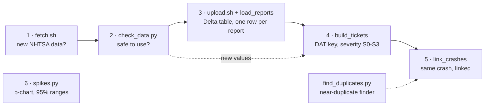

# triagepipeline

A small, tested pipeline that turns public crash reports of automated vehicles into triage tickets, built one step at a time.
Each step has its own issue, pull request and tests.

## How it fits together



Steps 1 and 2 run in a GitHub Codespace (Bash, Python); steps 3 to 5 run on Databricks (PySpark, SQL, Delta Lake); step 6 is a Python tool with a command line.

## Steps

| Step | Files | What it does | Tests |
|---|---|---|---|
| 1 | `scripts/fetch.sh` | Downloads NHTSA's two files, compares SHA-256 fingerprints, writes `data/status.txt` (changed or unchanged). A failed download stops with exit 22 and writes nothing. | `tests/test_fetch.sh` (4) |
| 2 | `scripts/check_data.py`, `config/known_values.json` | Five checks on each file: needed columns, a Report ID on every row, no repeated report version, not fewer rows than last time, and only checked values in the columns the severity rule reads. A bad file stops the run; a new value never does: it is listed in `data/new_values.csv` with 3 example reports. | `tests/test_check_data.py` (7) |
| 3 | `scripts/upload.sh`, `notebooks/load_reports.py` | Copies the files to a Databricks volume and MERGEs them into `workspace.triage.reports`: one row per report, only new or changed rows written (Change Data Feed on). | `tests/test_upload.py` (2) |
| 4 | `notebooks/build_tickets.py` | Reads only what changed since its last run, gives each report a permanent DAT key, a severity S0 to S3 and a pointer for exact copies, and MERGEs into `workspace.triage.tickets`. A ticket with a value nobody has checked gets at least S1 and `severity_pending` until the value is on the list. | checks in the notebook |
| 5 | `scripts/find_duplicates.py`, `notebooks/link_crashes.py` | Links tickets of the same crash: NHTSA's Same Incident ID first, then similar stories (TF-IDF, cut-off 0.9) in the same month and city; same minute = same crash, 1 to 10 minutes apart = a person decides. | `tests/test_find_duplicates.py` (6), checks in the notebook |
| 6 | `scripts/spikes.py` | For every month and value of a column (what the AV hit), compares the share with the 12 months before (a p-chart). Above normal + 3 standard errors with at least 3 rows = a spike; a value never seen before = a new value, not a spike. Each flag gets a Wilson 95% range. | `tests/test_spikes.py` (7) |

<details>
<summary><b>Why these numbers</b></summary>

- **3 sigmas (step 6):** when nothing changed, a share moves up and down by chance; it lands above normal + 3 standard errors only 1 time in 741 (`scipy.stats.norm.sf(3)` = 0.00135). On these crashes that is about 58 checks a year, so about 0.08 false alarms a year (2 sigmas: 1.3 a year).
- **At least 3 rows (step 6):** a value expected 0.5 times a month reaches 2 by chance 9% of the time, but 3 only 1.4% (`scipy.stats.poisson.sf(2, 0.5)`). A single report is never ignored: step 2 lists every new value and step 4 gives every ticket its own severity.
- **12 months (step 6):** one full year, so the seasons even out; `--window` changes it.
- **Shares, not counts (step 6):** NHTSA gives no miles driven, so a growing fleet alone must never flag.

</details>

## Run the tests

```bash
python3 -m pip install pandas numpy scikit-learn pytest
python3 -m pytest -v
bash tests/test_fetch.sh
```

## Data

[NHTSA Standing General Order crash reports](https://www.nhtsa.gov/laws-regulations/standing-general-order-crash-reporting), public data from the US government:
3,450 reports (1,899 on the form used until June 2025, 1,551 on the new form), 164 columns; the pipeline reads 13 of them.

<details>
<summary><b>All 164 columns: what each means, how many reports fill it, and which step uses it</b></summary>

| Column | What it means | Form | Filled (of 3,450) | Used by |
|---|---|---|---|---|
| Report ID | the report's id; each update of a report keeps it | old and new | 3,450 | steps 2 to 5 (the key of a report) |
| Report Version | 1 for the first filing, then 2, 3 ... for each update | old and new | 3,450 | steps 2 and 3 (keep the newest version) |
| Reporting Entity | the company that filed the report | old and new | 3,450 | step 4 (company) |
| Report Type | which kind of filing (for example a 5-day or a monthly report) | old and new | 3,450 |  |
| Report Month | the month the report was filed | old and new | 1,937 |  |
| Report Year | the year the report was filed | old and new | 1,937 |  |
| Report Submission Date | the date the report was filed | old and new | 3,450 |  |
| VIN | the vehicle identification number (partly masked) | old and new | 3,439 | step 5 (two vehicles) |
| VIN - Unknown | Y if the company did not know the VIN | old | 11 |  |
| Serial Number | a serial number for vehicles without a VIN (shuttles, robots) | old and new | 3,138 |  |
| Make | the vehicle make | old and new | 3,450 |  |
| Model | the vehicle model | old and new | 3,449 |  |
| Model - Unknown | Y if the model was not known | old and new | 1 |  |
| Model Year | the vehicle model year | old and new | 3,441 |  |
| Model Year - Unknown | Y if the model year was not known | old and new | 9 |  |
| Same Vehicle ID | NHTSA's id for one physical vehicle: every report about that vehicle shares it, across crashes | old and new | 3,439 |  |
| Mileage | the vehicle's odometer reading | old | 1,861 |  |
| Mileage - Unknown | Y if the mileage was not known | old | 38 |  |
| Driver / Operator Type | who could drive: in the vehicle, remote, both, a consumer, or None (no operator) | old and new | 3,450 |  |
| ADAS/ADS System Version | the automation system version | old | 1,693 |  |
| ADAS/ADS System Version - Unk | Y if 'ADAS/ADS System Version' was not known | old | 207 |  |
| ADAS/ADS System Version CBI | Y if 'ADAS/ADS System Version' is withheld as confidential business information | old | 297 |  |
| ADAS/ADS Hardware Version | the automation hardware version | old | 1,268 |  |
| ADAS/ADS Hardware Version - Unk | Y if 'ADAS/ADS Hardware Version' was not known | old | 117 |  |
| ADAS/ADS Hardware Version CBI | Y if 'ADAS/ADS Hardware Version' is withheld as confidential business information | old | 144 |  |
| ADAS/ADS Software Version | the automation software version | old | 1,269 |  |
| ADAS/ADS Software Version - Unk | Y if 'ADAS/ADS Software Version' was not known | old | 115 |  |
| ADAS/ADS Software Version CBI | Y if 'ADAS/ADS Software Version' is withheld as confidential business information | old | 145 |  |
| Other Reporting Entities? | whether another company also reported this crash | old | 400 |  |
| Other Reporting Entities? - Unk | Y if 'Other Reporting Entities?' was not known | old | 6 |  |
| Other Reporting Entities? - NA | Y if 'Other Reporting Entities?' was not applicable | old | 1,011 |  |
| Federal Regulatory Exemption? | whether the vehicle runs under a federal exemption | old | 22 |  |
| Other Federal Reg. Exemption | which other federal exemption | old | 5 |  |
| Federal Reg. Exemption - Unk | Y if 'Federal Reg. Exemption' was not known | old | 13 |  |
| Federal Reg. Exemption - No | Y if 'Federal Reg. Exemption' was no | old | 1,382 |  |
| State or Local Permit? | whether the vehicle runs under a state or local permit | old | 1,417 |  |
| State or Local Permit | which permit | old | 1,206 |  |
| ADS Equipped? | whether the vehicle has an automated driving system | old | 1,899 |  |
| Automation System Engaged? | whether the automation was engaged at the time | old and new | 3,450 |  |
| Operating Entity | the company operating the vehicle | old and new | 3,442 |  |
| Operating Entity - Unknown | Y if 'Operating Entity' was not known | old and new | 0 |  |
| Source - Complaint/Claim | Y if the company learned of the crash from: Complaint/Claim | old and new | 35 |  |
| Source - Telematics | Y if the company learned of the crash from: Telematics | old and new | 2,921 |  |
| Source - Law Enforcement | Y if the company learned of the crash from: Law Enforcement | old and new | 13 |  |
| Source - Field Report | Y if the company learned of the crash from: Field Report | old and new | 806 |  |
| Source - Testing | Y if the company learned of the crash from: Testing | old and new | 365 |  |
| Source - Media | Y if the company learned of the crash from: Media | old and new | 2 |  |
| Source - Other | Y if the company learned of the crash from: Other | old | 29 |  |
| Source - Other Text | the other source, in words | old | 29 |  |
| Incident Date | the month of the crash (NHTSA gives month and year only) | old and new | 3,449 | steps 4 and 6 (month) |
| Incident Date - Unknown | Y if 'Incident Date' was not known | old and new | 1 |  |
| Notice Received Date | when the company learned of the crash | old | 1,899 |  |
| Incident Time (24:00) | the time of day of the crash, HH:MM | old and new | 3,446 | steps 4 and 5 (same minute) |
| Incident Time - Unknown | Y if 'Incident Time' was not known | old and new | 4 |  |
| Same Incident ID | NHTSA's id for one vehicle in one crash: every company's report of it shares it | old and new | 3,438 | step 5 (same crash) |
| Latitude | where the crash was (almost always hidden) | old and new | 3,391 |  |
| Latitude - Unknown | Y if 'Latitude' was not known | old and new | 59 |  |
| Longitude | where the crash was (almost always hidden) | old and new | 3,391 |  |
| Longitude - Unknown | Y if 'Longitude' was not known | old and new | 59 |  |
| Address | the street (almost always hidden) | old and new | 3,256 |  |
| Address - Unknown | Y if 'Address' was not known | old and new | 1 |  |
| City | the city | old and new | 3,445 | steps 4 and 5 (exact copies, same crash) |
| City - Unknown | Y if 'City' was not known | old and new | 2 |  |
| State | the state | old and new | 3,448 |  |
| Zip Code | the zip code (almost always hidden) | old and new | 3,236 |  |
| Zip Code - Unknown | Y if 'Zip Code' was not known | old and new | 21 |  |
| Roadway Type | the kind of road (street, intersection, highway, parking lot ...) | old and new | 3,450 |  |
| Roadway Surface | dry, wet ... | old | 1,899 |  |
| Roadway Description | free text about the road | old | 1,899 |  |
| Posted Speed Limit (MPH) | the speed limit where the crash happened | old | 1,875 |  |
| Posted Speed Limit - Unknown | Y if 'Posted Speed Limit' was not known | old | 24 |  |
| Lighting | daylight, dark, dawn or dusk | old | 1,899 |  |
| Weather - Clear | Y if the weather included: Clear | old and new | 2,659 |  |
| Weather - Snow | Y if the weather included: Snow | old and new | 1 |  |
| Weather - Cloudy | Y if the weather included: Cloudy | old and new | 504 |  |
| Weather - Fog/Smoke | Y if the weather included: Fog/Smoke | old | 3 |  |
| Weather - Rain | Y if the weather included: Rain | old and new | 130 |  |
| Weather - Severe Wind | Y if the weather included: Severe Wind | old and new | 2 |  |
| Weather - Unknown | Y if the weather included: Unknown | old | 26 |  |
| Weather - Other | Y if the weather included: Other | old | 2 |  |
| Weather - Other Text | the other weather, in words | old | 2 |  |
| Crash With | what the AV hit or was hit by | old and new | 3,450 | steps 2, 4 and 6 (severity, spikes) |
| Highest Injury Severity Alleged | the worst injury anyone reported | old and new | 3,450 | steps 2 and 4 (severity) |
| Property Damage? | whether there was property damage | old | 1,899 |  |
| CP Pre-Crash Movement | what the other party was doing just before | old and new | 3,297 |  |
| CP Any Air Bags Deployed? | whether an airbag deployed in the other vehicle (old form) | old | 1,745 |  |
| CP Was Vehicle Towed? | whether the other vehicle was towed (old form) | old | 1,745 |  |
| CP Contact Area - Rear Left | Y if the other party was hit on: Rear Left | old and new | 205 |  |
| CP Contact Area - Left | Y if the other party was hit on: Left | old and new | 301 |  |
| CP Contact Area - Front Left | Y if the other party was hit on: Front Left | old and new | 556 |  |
| CP Contact Area - Rear | Y if the other party was hit on: Rear | old and new | 184 |  |
| CP Contact Area - Top | Y if the other party was hit on: Top | old and new | 7 |  |
| CP Contact Area - Front | Y if the other party was hit on: Front | old and new | 712 |  |
| CP Contact Area - Rear Right | Y if the other party was hit on: Rear Right | old and new | 272 |  |
| CP Contact Area - Right | Y if the other party was hit on: Right | old and new | 439 |  |
| CP Contact Area - Front Right | Y if the other party was hit on: Front Right | old and new | 825 |  |
| CP Contact Area - Bottom | Y if the other party was hit on: Bottom | old and new | 11 |  |
| CP Contact Area - Unknown | Y if the other party was hit on: Unknown | old and new | 300 |  |
| SV Pre-Crash Movement | what the AV was doing just before | old and new | 3,450 |  |
| SV Any Air Bags Deployed? | whether an AV airbag deployed (old form) | old | 1,899 | steps 2 and 4 (severity, old form) |
| SV Was Vehicle Towed? | whether the AV was towed (old form) | old | 1,899 |  |
| SV Were All Passengers Belted? | whether all AV passengers wore seat belts (old form) | old | 1,899 |  |
| SV Precrash Speed (MPH) | the AV's speed just before the crash | old and new | 3,431 |  |
| SV Pre-crash Speed - Unknown | Y if 'SV Pre-crash Speed' was not known | old and new | 19 |  |
| SV Contact Area - Rear Left | Y if the AV was hit on: Rear Left | old and new | 693 |  |
| SV Contact Area - Left | Y if the AV was hit on: Left | old and new | 309 |  |
| SV Contact Area - Front Left | Y if the AV was hit on: Front Left | old and new | 383 |  |
| SV Contact Area - Rear | Y if the AV was hit on: Rear | old and new | 813 |  |
| SV Contact Area - Top | Y if the AV was hit on: Top | old and new | 28 |  |
| SV Contact Area - Front | Y if the AV was hit on: Front | old and new | 398 |  |
| SV Contact Area - Rear Right | Y if the AV was hit on: Rear Right | old and new | 690 |  |
| SV Contact Area - Right | Y if the AV was hit on: Right | old and new | 228 |  |
| SV Contact Area - Front Right | Y if the AV was hit on: Front Right | old and new | 437 |  |
| SV Contact Area - Bottom | Y if the AV was hit on: Bottom | old and new | 142 |  |
| SV Contact Area - Unknown | Y if the AV was hit on: Unknown | old and new | 30 |  |
| Data Availability - EDR | Y if this record of the crash exists: EDR | old and new | 364 |  |
| Data Availability - Police Rpt | Y if this record of the crash exists: Police Rpt | old and new | 117 |  |
| Data Availability - Telematics | Y if this record of the crash exists: Telematics | old and new | 3,221 |  |
| Data Availability - Complaints | Y if this record of the crash exists: Complaints | old and new | 18 |  |
| Data Availability - Video | Y if this record of the crash exists: Video | old and new | 3,395 |  |
| Data Availability - Other | Y if this record of the crash exists: Other | old and new | 1,693 |  |
| Data Availability - No Data | Y if this record of the crash exists: No Data | old and new | 3 |  |
| Data Availability - Unknown | Y if this record of the crash exists: Unknown | old and new | 13 |  |
| Law Enforcement Investigating? | whether the police investigated | old | 1,899 |  |
| Investigating Agency | which agency investigated | old and new | 1,954 |  |
| Investigating Agency - Unknown | Y if 'Investigating Agency' was not known | old and new | 55 |  |
| Rep Ent Or Mfr Investigating? | whether the company is investigating | old | 1,899 |  |
| Investigating Officer Name | the officer's name (hidden) | old | 364 |  |
| Inv. Officer Name - Unknown | Y if 'Inv. Officer Name' was not known | old | 94 |  |
| Investigating Officer Phone | the officer's phone (hidden) | old | 106 |  |
| Inv. Officer Phone - Unknown | Y if 'Inv. Officer Phone' was not known | old | 352 |  |
| Investigating Officer Email | the officer's email (hidden) | old | 34 |  |
| Inv. Officer Email - Unknown | Y if 'Inv. Officer Email' was not known | old | 424 |  |
| Within ODD? | whether the AV was inside the conditions it was designed for | old and new | 3,450 |  |
| Within ODD? - CBI | Y if the answer to 'Within ODD?' is withheld as confidential business information | old and new | 227 |  |
| Narrative | the company's story of the crash (free text; often partly redacted) | old and new | 3,450 | steps 4 and 5 (the story) |
| Narrative - CBI? | Y if part of the story is withheld as confidential business information | old and new | 223 |  |
| VIN Decoded | make and model decoded from the VIN | new | 1,551 |  |
| Make - Unknown | Y if the make was not known | new | 0 |  |
| Automation Feature Version | the automation version (new form) | new | 1,551 |  |
| Automation Feature Version CBI | Y if 'Automation Feature Version' is withheld as confidential business information | new | 44 |  |
| Engagement Status | the automation's state at the time (new form) | new | 1,551 |  |
| Source - Internal Process Review | Y if the company learned of the crash from: Internal Process Review | new | 14 |  |
| Source - NHTSA VOQ | Y if the company learned of the crash from: NHTSA VOQ | new | 0 |  |
| Source - Other - See Narrative | Y if the company learned of the crash from: Other - See Narrative | new | 0 |  |
| Source - Other Entity | Y if the company learned of the crash from: Other Entity | new | 0 |  |
| Source - State or Other Agency | Y if the company learned of the crash from: State or Other Agency | new | 0 |  |
| Roadway-Degraded Surface | Y if the road had: Degraded Surface (new form) | new | 15 |  |
| Roadway-Missing/Degraded Marking | Y if the road had: Missing/Degraded Marking (new form) | new | 2 |  |
| Roadway-No Unusual Conditions | Y if the road had: No Unusual Conditions (new form) | new | 1,439 |  |
| Roadway-Other-See Narrative | Y if the road had: Other-See Narrative (new form) | new | 31 |  |
| Roadway-Traffic Incident | Y if the road had: Traffic Incident (new form) | new | 8 |  |
| Roadway-Unknown | Y if the road had: Unknown (new form) | new | 0 |  |
| Roadway-Wet Surface Condition | Y if the road had: Wet Surface Condition (new form) | new | 36 |  |
| Roadway-Work Zone | Y if the road had: Work Zone (new form) | new | 27 |  |
| Weather - Partly Cloudy | Y if the weather included: Partly Cloudy | new | 141 |  |
| Weather - Fog/Smoke/Haze | Y if the weather included: Fog/Smoke/Haze | new | 1 |  |
| Weather - Dust Storm | Y if the weather included: Dust Storm | new | 1 |  |
| Weather - Severe Hurricane | Y if the weather included: Severe Hurricane | new | 0 |  |
| Weather - Structure-Indoor | Y if the weather included: Structure-Indoor | new | 2 |  |
| Weather - Unk - See Narrative | Y if the weather included: Unk - See Narrative | new | 0 |  |
| Any Air Bags Deployed? | whether any airbag deployed (new form) | new | 1,551 | steps 2 and 4 (severity, new form) |
| Was Any Vehicle Towed? | whether any vehicle was towed (new form) | new | 1,551 |  |
| Were All Passengers Belted? | whether all passengers wore seat belts (new form) | new | 1,551 |  |

</details>
